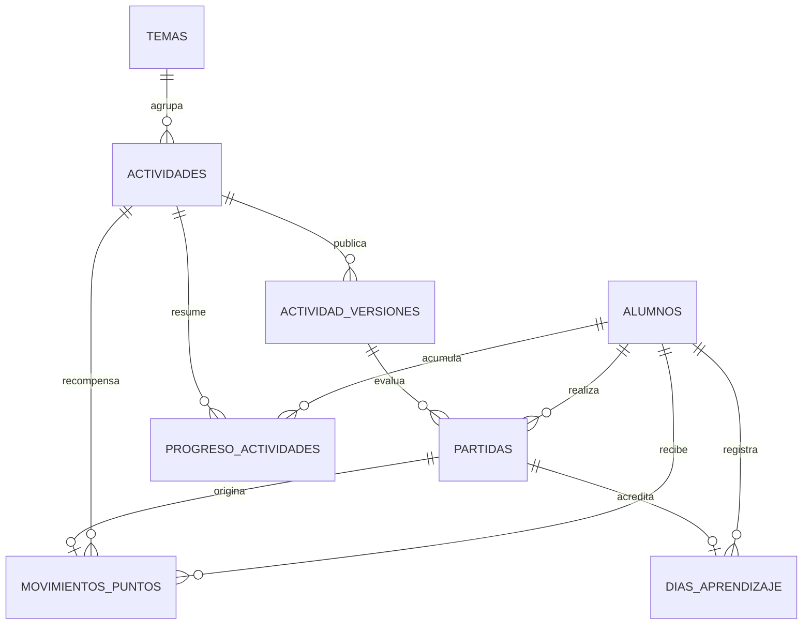

# Contexto del backend: alumnos y aprendizaje gamificado

Responsable del backend: Emily.

Estado: MVP de backend implementado hasta controladores. Las reglas propuestas en este documento se adoptaron como valores iniciales; los cambios posteriores deben reflejarse en código y nuevas migraciones. Consultar [la guía del backend](../backend/README.md) para configurar Auth, ejecutar y probar los endpoints.

## 1. Propósito y estado del proyecto

La aplicación es una plataforma de acompañamiento educativo para aprender y repasar matemáticas mediante juegos y gamificación. Cada alumno podrá practicar, avanzar en el contenido, obtener puntos, subir de nivel, mantener una racha y consultar su posición en un ranking.

El repositorio contiene un frontend base en React y TypeScript, y un backend en Java 21 con Spring Boot, JPA y Flyway. PostgreSQL en Supabase almacena los datos. El backend incluye entidades, migraciones, servicios, repositorios, DTO y controladores; valida tokens de Supabase Auth. La integración del frontend y su cola offline sigue pendiente.

Este documento desarrolla el contexto de alumnos. Incluye las entidades mínimas de contenido necesarias para explicar sus relaciones; la autoría de juegos, profesores, tutores, aulas, pagos y administración de contenidos queda fuera de este primer alcance.

Las tablas de negocio vivirán en el esquema `math_portal`. Flyway administrará las migraciones y JPA validará el esquema, de acuerdo con [la arquitectura existente](architecture.md). La sincronización debe respetar [el plan offline](offline.md).

## 2. Conceptos del dominio

| Objeto | Significado |
| --- | --- |
| Alumno | Persona que aprende; tiene una identidad privada y un alias para mostrar. |
| Tema | Área de matemáticas, por ejemplo sumas, restas o fracciones. |
| Actividad | Juego o reto publicado de un tema, con dificultad y recompensa definidas. |
| Versión de actividad | Definición inmutable del reto que el alumno resolvió; permite evaluar contenido descargado anteriormente. |
| Partida | Ejecución de una actividad por un alumno, con sus respuestas y resultado. |
| Progreso de actividad | Resumen del avance de un alumno en una actividad. |
| Movimiento de puntos | Registro de los puntos otorgados por una partida validada. |
| Nivel de alumno | Rango de experiencia alcanzado por puntos acumulados. |
| Día de aprendizaje | Día local en que el alumno cumple la condición para sumar racha. |
| Racha | Cantidad de días consecutivos de aprendizaje. |
| Ranking | Clasificación calculada a partir de los puntos válidos. |

**Distinción:** el nivel de alumno representa experiencia; la dificultad pertenece a la actividad. Subir de nivel no demuestra por sí solo el dominio de un tema. El dominio se observa mediante resultados y progreso.

## 3. Recorrido principal del alumno

1. Inicia sesión y accede a su perfil.
2. Consulta temas, actividades y progreso previo.
3. Juega una actividad y envía sus respuestas, inmediatamente o al recuperar conexión.
4. El backend verifica la identidad, la versión de la actividad y las respuestas.
5. Guarda el resultado y, si corresponde, otorga puntos y registra el día de aprendizaje.
6. El alumno consulta su progreso, nivel, racha y ranking actualizados.

## 4. Reglas propuestas para el MVP

### Identidad y perfil

- Una identidad autenticada tiene como máximo un perfil de alumno.
- Se utiliza Supabase Auth; `auth_subject` corresponde al identificador de su usuario. El backend valida firma, emisor, audiencia y vigencia del token antes de usarlo.
- El identificador del alumno se obtiene de la identidad autenticada; el cliente no puede elegir a quién acreditar puntos.
- El alias es un nombre de presentación y no necesita ser único. El ranking nunca muestra correo, nombre real ni identificadores de autenticación.
- La participación en el ranking es voluntaria, desactivada inicialmente. Los perfiles inactivos no aparecen.
- No se requieren fecha de nacimiento, dirección ni datos del centro educativo para este MVP. El grado escolar es opcional.

### Puntos y niveles

- Propuesta: usar una sola unidad de puntos de experiencia (XP). Por ahora no existe una moneda que se pueda gastar.
- Cada actividad tiene una recompensa base entera, no negativa, fijada en su versión publicada.
- Una partida cuenta como aprobada si alcanza el criterio de aprobación de esa versión. El backend calcula el resultado; no acepta puntuaciones calculadas por el cliente como definitivas.
- Solo la primera aprobación de cada actividad por alumno otorga su recompensa base. Las repeticiones actualizan el historial y la mejor puntuación, pero no generan XP adicionales, incluso si cambia la versión.
- Los errores no descuentan XP. Bonificaciones, compras, penalizaciones y ajustes manuales quedan fuera del MVP.
- Los XP totales son la suma de los movimientos de puntos. El nivel actual es el nivel cuyo umbral es el mayor que no supera esos XP.
- Ejemplo de umbrales iniciales, ajustables: nivel 1 desde 0 XP, nivel 2 desde 100 XP y nivel 3 desde 250 XP.
- El nivel inicial está disponible desde el registro. No se persiste un segundo contador de XP ni un nivel actual en `alumnos` durante el MVP para evitar inconsistencias.

### Rachas

- Propuesta: un día cuenta cuando el alumno aprueba al menos una actividad. También cuenta una repetición aunque ya no otorgue XP.
- Varias actividades el mismo día suman un solo día de racha.
- La fecha se calcula en el backend usando la zona horaria IANA del alumno; propuesta de valor inicial: `America/Guatemala`.
- La racha actual es la secuencia consecutiva que termina hoy o ayer. Si la última actividad fue antes de ayer, la racha actual es cero. La racha máxima es la mayor secuencia histórica.
- No hay congeladores ni recuperaciones de racha en el MVP.
- Los cambios de zona horaria solo afectan las nuevas partidas; no reescriben días históricos ya registrados.

### Ranking

- Propuesta: ranking global de alumnos participantes por XP totales en orden descendente.
- En empates se comparte la posición: usar `RANK()` sobre los XP, por ejemplo 1, 1, 3. Para ordenar de forma estable a los empatados puede usarse el UUID del alumno, sin incluirlo en el cálculo de posición.
- Solo participan alumnos activos que hayan aceptado aparecer y tengan al menos un movimiento de puntos.
- Mostrar alias, nivel, XP y posición, con paginación. Calcular la posición sobre todos los participantes antes de paginar.
- El ranking es una consulta o vista, no una tabla editable por el cliente. Una tabla de posiciones almacenadas solo sería necesaria al introducir cierres de temporada o necesidades de rendimiento.
- Rankings semanales, por grado o por aula quedan para una siguiente etapa. Requerirán definir alcance, calendario y zona horaria común.

### Partidas offline y consistencia

- Cada partida lleva un UUID generado por el cliente y reutilizado en todos sus reintentos de sincronización. No es un UUID nuevo por petición HTTP.
- La versión publicada de una actividad es inmutable. Un cambio de preguntas o reglas crea una versión nueva.
- El backend valida partidas descargadas contra la versión correspondiente. Si una versión ya no puede evaluarse, devuelve un error explícito sin otorgar puntos.
- Propuesta inicial: una partida offline validada recibe XP al sincronizarse y cuenta para la racha en la fecha local de recepción del servidor. La fecha declarada por el dispositivo se conserva como referencia, sin usarla para acreditar días anteriores.
- Esta regla implica que practicar offline durante varios días y sincronizar todo junto acredita un solo día de racha. Reconocer fechas offline históricas requiere otro diseño de confianza y queda pendiente.
- Reenviar una partida con el mismo UUID y contenido devuelve el resultado guardado. Reutilizar ese UUID con otro alumno o contenido produce conflicto.
- Guardar partida, progreso, puntos y día de aprendizaje es una única transacción. Los cambios concurrentes del mismo alumno y actividad requieren bloqueo o una operación atómica para preservar el mejor resultado y evitar recompensas duplicadas.

## 5. Tablas propuestas

Convenciones: claves primarias UUID salvo donde se indique otra cosa; instantes como `timestamptz` en UTC; fechas de racha como `date`; nombres SQL en `snake_case`. Los campos son obligatorios salvo que se indique que son opcionales. Las FK deben tener índices en las consultas frecuentes y no se borran historiales en cascada.

### `alumnos`

Perfil del alumno, separado de las credenciales de acceso.

| Campo | Tipo | Regla |
| --- | --- | --- |
| `id` | UUID, PK | Identificador interno. |
| `auth_subject` | varchar(255), UNIQUE | Identidad del proveedor de autenticación elegido. |
| `alias` | varchar(40) | Nombre visible; validar longitud y contenido. |
| `avatar_clave` | varchar(100), opcional | Identificador de un avatar del catálogo inicial. |
| `grado_escolar` | varchar(30), opcional | Dato descriptivo; no determina permisos. |
| `zona_horaria` | varchar(100) | Identificador IANA validado por el backend. |
| `participa_ranking` | boolean | Valor inicial `false`. |
| `estado` | varchar(20) | `ACTIVO` o `INACTIVO`, con CHECK. |
| `creado_en`, `actualizado_en` | timestamptz | Auditoría básica. |

No guardar contraseñas en esta tabla. El correo, si lo requiere el inicio de sesión, pertenece al proveedor de autenticación y no al perfil público.

### `niveles_alumno`

Catálogo de rangos de experiencia, independiente de los temas.

| Campo | Tipo | Regla |
| --- | --- | --- |
| `id` | UUID, PK | Identificador. |
| `numero` | integer, UNIQUE | Positivo y correlativo. |
| `nombre` | varchar(80) | Nombre visible del nivel. |
| `xp_minimos` | bigint, UNIQUE | Umbral no negativo. |

La carga inicial debe incluir el nivel 1 con 0 XP. Los umbrales aumentan con el número de nivel; validar esta regla en la carga del catálogo o servicio, porque compara filas diferentes.

### `temas`, `actividades` y `actividad_versiones`

Soporte mínimo de contenido; su diseño detallado se completará en el módulo correspondiente.

| Tabla | Campos mínimos | Restricciones |
| --- | --- | --- |
| `temas` | `id`, `nombre`, `orden`, `activo` | Orden no negativo. |
| `actividades` | `id`, `tema_id` FK, `titulo`, `tipo_juego`, `orden`, `activa` | Cada actividad pertenece a un tema. |
| `actividad_versiones` | `id`, `actividad_id` FK, `numero_version`, `dificultad`, `contenido` JSONB, `reglas_evaluacion` JSONB, `xp_recompensa` integer, `publicada_en` | UNIQUE (`actividad_id`, `numero_version`); versión positiva; recompensa no negativa; publicada = inmutable. |

`reglas_evaluacion` contiene el criterio de aprobación y la información privada necesaria para corregir. No se devuelve automáticamente al frontend. Los DTO de descarga deben definir qué se puede mostrar y qué implicaría permitir corrección offline.

### `partidas`

Historial de actividades finalizadas y enviadas para evaluación. Una partida en curso puede permanecer local; no requiere una fila remota hasta su envío.

| Campo | Tipo | Regla |
| --- | --- | --- |
| `id` | UUID, PK | Generado por el cliente; clave de idempotencia. |
| `alumno_id` | UUID, FK → `alumnos` | Propietario autenticado. |
| `actividad_version_id` | UUID, FK → `actividad_versiones` | Contenido exacto que resolvió. |
| `respuestas` | JSONB | Respuestas enviadas; tamaño y estructura validados según el juego. |
| `puntaje_porcentaje` | numeric(5,2) | De 0 a 100, calculado por el backend. |
| `aprobada` | boolean | Resultado según la versión. |
| `origen` | varchar(10) | `ONLINE` u `OFFLINE`, con CHECK; dato informativo del cliente. |
| `finalizada_cliente_en` | timestamptz, opcional | Referencia declarada por el dispositivo. |
| `recibida_en` | timestamptz | Momento registrado por el servidor. |
| `fecha_aprendizaje` | date | Día local de recepción, fijado al aceptar la partida. |
| `zona_horaria_aplicada` | varchar(100) | Zona del perfil usada para calcular esa fecha. |

Índice sugerido: (`alumno_id`, `recibida_en`). En el MVP solo se persisten partidas evaluadas correctamente; una solicitud inválida devuelve un error, sin producir progreso o recompensas. Las respuestas pueden contener datos privados y requieren acceso exclusivo del propietario.

### `progreso_actividades`

Resumen reconstruible desde las partidas. No sustituye el historial.

| Campo | Tipo | Regla |
| --- | --- | --- |
| `alumno_id` | UUID, FK → `alumnos` | Parte de la PK compuesta. |
| `actividad_id` | UUID, FK → `actividades` | Parte de la PK compuesta. |
| `intentos` | integer | Mayor que cero; número de partidas aceptadas. |
| `mejor_puntaje` | numeric(5,2) | De 0 a 100. |
| `primera_aprobacion_en` | timestamptz, opcional | Se establece una sola vez; nulo si aún no aprueba. |
| `ultima_partida_en` | timestamptz | Última recepción aceptada. |

Sin fila significa `NO_INICIADA`; con fila y sin aprobación significa `EN_PROGRESO`; con primera aprobación significa `COMPLETADA`. El progreso por tema se deriva de sus actividades activas completadas. Publicar una nueva actividad puede cambiar ese porcentaje.

### `movimientos_puntos`

Fuente de verdad de los XP otorgados; registros inmutables para el MVP.

| Campo | Tipo | Regla |
| --- | --- | --- |
| `id` | UUID, PK | Identificador. |
| `alumno_id` | UUID, FK → `alumnos` | Beneficiario. |
| `actividad_id` | UUID, FK → `actividades` | Actividad recompensada. |
| `partida_id` | UUID, FK → `partidas`, UNIQUE | Partida que originó la recompensa. |
| `cantidad` | integer | Mayor que cero; copia de los XP de la versión evaluada. |
| `otorgado_en` | timestamptz | Momento del servidor. |

UNIQUE (`alumno_id`, `actividad_id`) garantiza una sola recompensa por actividad. El servicio debe comprobar que alumno y actividad coinciden con la partida, y que esta está aprobada. Las actividades de recompensa cero no generan movimiento. Un índice por `alumno_id` facilita calcular XP y ranking.

### `dias_aprendizaje`

Calendario mínimo para calcular racha actual y máxima sin guardar contadores que puedan quedar desactualizados.

| Campo | Tipo | Regla |
| --- | --- | --- |
| `alumno_id` | UUID, FK → `alumnos` | Parte de la PK compuesta. |
| `fecha` | date | Parte de la PK compuesta; fecha acreditada. |
| `primera_partida_id` | UUID, FK → `partidas`, UNIQUE | Primera partida aprobada que acreditó el día. |
| `creado_en` | timestamptz | Momento de registro. |

El servicio verifica que la partida pertenezca al alumno, esté aprobada y corresponda a la fecha registrada. La PK evita contar dos veces el mismo día; una inserción concurrente del día existente se trata como operación sin cambios.

## 6. Relaciones

`niveles_alumno` no requiere FK desde `alumnos`: el nivel se obtiene comparando los XP acumulados con los umbrales. El ranking, las rachas y el progreso por tema son objetos de consulta derivados de estas tablas.

## 7. Organización y contratos iniciales del backend

Conservar la estructura por módulos y capas prevista en el repositorio:

- `auth`: validación de identidad y resolución del alumno autenticado.
- `students` (nuevo): perfil y preferencias del alumno.
- `topics` y `exercises`: temas, actividades, versiones y evaluación de respuestas.
- `progress`: partidas, progreso, puntos, niveles, rachas y ranking para el MVP.

Las entidades JPA representan las tablas; los DTO definen la información que recibe o devuelve la API. No exponer directamente las entidades ni aceptar XP, nivel, racha o posición como campos editables.

| Contrato propuesto | Responsabilidad |
| --- | --- |
| `POST /api/students/me` | Crear el perfil de la identidad autenticada; impedir perfiles duplicados. |
| `GET /api/students/me` | Consultar el perfil privado. |
| `PATCH /api/students/me` | Editar alias, avatar, grado, zona horaria y participación en ranking. |
| `GET /api/students/me/progress` | Consultar XP, nivel, siguiente umbral, racha actual y máxima, y avance por tema. |
| `GET /api/students/me/activities/{activityId}/progress` | Consultar intentos, mejor resultado y estado de una actividad. |
| `POST /api/attempts` | Evaluar y registrar una partida con su UUID; devolver resultado, XP otorgados y resumen actualizado. |
| `GET /api/students/me/attempts` | Consultar historial paginado del propio alumno. |
| `GET /api/levels` | Consultar catálogo de niveles y umbrales. |
| `GET /api/ranking` | Consultar ranking paginado con los campos públicos definidos. |

Todos requieren autenticación para el MVP. El prefijo `/api` ya está configurado como context path en Spring; no se duplica en las rutas de los controladores. La sincronización inicial puede reenviar partidas individualmente mediante `POST /api/attempts`; un envío por lotes no es necesario para esta primera versión.

## 8. Orden sugerido de implementación

1. Elegir proveedor de autenticación y cerrar las reglas propuestas de puntos, ranking y racha offline.
2. Crear migraciones Flyway con restricciones, índices y catálogo inicial de niveles.
3. Implementar identidad, alta y edición del perfil con autorización por propietario.
4. Crear el contenido mínimo versionado y la evaluación de partidas.
5. Implementar la transacción de partida, progreso, recompensa y día de aprendizaje, incluida la idempotencia.
6. Exponer los resúmenes, el historial y el ranking.
7. Integrar la cola offline y comprobar sincronización repetida y concurrente.

## 9. Criterios de aceptación del diseño

- Un alumno nuevo comienza con 0 XP, nivel 1, racha 0 y sin progreso.
- Aprobar por primera vez una actividad de 50 XP suma exactamente 50 XP y completa esa actividad.
- Reenviar esa partida conserva el mismo resultado y no modifica contadores ni recompensas.
- Aprobar otra partida de la misma actividad puede mejorar la puntuación y sumar un día de aprendizaje, pero no vuelve a otorgar XP.
- Dos aprobaciones simultáneas de la misma actividad generan una sola recompensa; ambas partidas válidas se conservan.
- Una partida no aprobada cuenta como intento y puede mejorar el puntaje, pero no acredita XP ni día de racha.
- Aprender hoy y mañana produce una racha de 2; dejar un día completo sin aprendizaje interrumpe la continuidad.
- Cruzar un umbral de XP cambia el nivel calculado, sin modificar el historial de puntos.
- Sincronizar varias veces una partida offline no duplica resultados; varias partidas recibidas el mismo día solo acreditan ese día.
- Cambiar la zona horaria no reescribe fechas de aprendizaje ya acreditadas.
- El ranking excluye perfiles que no participan y mantiene la posición compartida de los empates incluso al paginar.
- Un alumno no puede consultar ni modificar el perfil, las partidas o el progreso privado de otro.

## 10. Decisiones pendientes del equipo

- Configurar Supabase Auth con firma asimétrica y elegir el método de inicio de sesión apropiado para los alumnos objetivo en el frontend.
- Catálogo inicial de temas, juegos, dificultades y reglas de aprobación.
- Recompensas y umbrales definitivos, y si los niveles desbloquearán contenido. Para el MVP propuesto las actividades activas están disponibles sin bloqueos.
- Confirmar si las repeticiones deben dar XP; de cambiar esta regla, revisar la unicidad de las recompensas y sus límites.
- Confirmar la acreditación de rachas offline por fecha de sincronización o diseñar un mecanismo para reconocer fechas históricas.
- Definir conservación de respuestas y eliminación o anonimización de cuentas antes de incorporar alumnos reales; desactivar un perfil no equivale a eliminar sus datos.

Logros, insignias, monedas, tiendas, ligas, temporadas y relaciones con profesores o tutores quedan como ampliaciones futuras.
